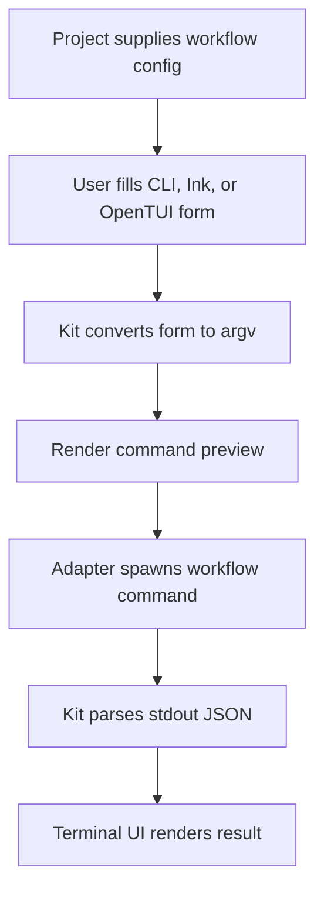

# @gg-utils/testing-identities-kit

Reusable testing-identity workflow contracts, argv builders, command previews, JSON parsers, child
process bridges, and terminal shells.

Use this kit when a repository has scripted testing-identity workflows and wants package-safe
classic, Ink, or OpenTUI operator UIs around project-supplied workflow definitions.

## Install

```bash
npm install @gg-utils/testing-identities-kit@git+https://github.com/gg-utils/testing-identities-kit.git#main
```

Pinned dependency example:

```json
{
  "dependencies": {
    "@gg-utils/testing-identities-kit": "git+https://github.com/gg-utils/testing-identities-kit.git#f7ed33c"
  }
}
```

## When To Use

- You need typed workflow contracts for testing identity allocation, release, or inspection flows.
- You need pure argv builders from form state.
- You need terminal command previews or final JSON-object parsing.
- You need reusable Ink/OpenTUI/classic menus driven by project workflow config.

## Public Surfaces

| Import | Purpose |
|---|---|
| `@gg-utils/testing-identities-kit/contracts` | Workflow, form, and config contracts. |
| `@gg-utils/testing-identities-kit/build-argv` | Build command argv from workflow choices. |
| `@gg-utils/testing-identities-kit/form-to-argv` | Convert form state to argv. |
| `@gg-utils/testing-identities-kit/format-preview` | Format command previews. |
| `@gg-utils/testing-identities-kit/parse-stdout-json` | Parse final JSON objects from stdout. |
| `@gg-utils/testing-identities-kit/spawn-npx-tsx` | Cancelable `npx tsx` bridge. |
| `@gg-utils/testing-identities-kit/ink-app` | Reusable Ink workflow UI. |
| `@gg-utils/testing-identities-kit/opentui-app` | Reusable OpenTUI workflow UI. |
| `@gg-utils/testing-identities-kit/interactive-menu` | Classic terminal menu helpers. |

## Quick Start

```ts
import {
  TestingIdentitiesKit_buildArgv,
  TestingIdentitiesKit_parseLastJsonObject,
} from "@gg-utils/testing-identities-kit";

const argv = TestingIdentitiesKit_buildArgv({
  purpose: "e2e",
  runId: "run-123",
  workflow: "allocate",
});

const result = TestingIdentitiesKit_parseLastJsonObject('log\n{"ok":true}\n');
console.log({ argv, result });
```

## Operational Flow



## Development

```bash
git clone https://github.com/gg-utils/testing-identities-kit.git
cd testing-identities-kit
npm run type-check
npm test
npm run build
```

Scripts currently expect the source-first workspace toolchain.

## Layout

```text
.
|-- src/contracts.ts
|-- src/build-argv.ts
|-- src/form-to-argv.ts
|-- src/format-preview.ts
|-- src/parse-stdout-json.ts
|-- src/ink-app.tsx
|-- src/opentui-app.tsx
|-- dist/
`-- package.json
```

## Caveats

- The kit does not define your test accounts or credentials.
- Workflow definitions and command paths are adapter-owned.
- Child-process helpers execute only when called by a consumer.

## Use from another repository

Add this dependency to your `package.json` and install normally; compiled ESM and declarations are included in the tag, with no consumer build step.

```json
"@gg-utils/testing-identities-kit": "git+https://github.com/gg-utils/testing-identities-kit.git#v0.2.0"
```

Requires Node `>=22.0.0 <27` (Node 22, 24, and 26).
